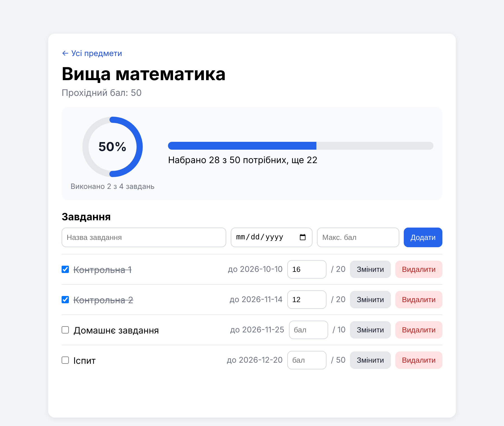

# TaskStudent

Веб-застосунок для студента: облік предметів, завдань і балів в одному місці.
Викладачі дають завдання у своїх системах, а TaskStudent допомагає студенту бачити свій прогрес:
скільки завдань уже виконано і скільки балів ще потрібно для заліку.

Автор: Макартич'ян Володимир Арменович.

## Функції

1. Реєстрація та вхід (один тип користувача - студент).
2. Предмети: назва та прохідний бал.
3. Завдання: назва, опис, дедлайн, максимальний бал, статус (нове / виконано), отриманий бал.
4. Прогрес по предмету: кільце з відсотком виконаних завдань (10 з 10 = 100%, 5 з 10 = 50%).
5. Бали по предмету: смуга "набрано N з прохідного M" і попередження, якщо прохідний бал уже недосяжний.

Користувач бачить і змінює тільки свої дані: чужі предмети й завдання повертають 404.



## Технології

Python 3.13, Flask 3.1, SQLite, pytest. Інтерфейс: звичайні HTML, CSS і JavaScript без бібліотек.

## Запуск

```bash
python -m venv venv
source venv/bin/activate        # Windows: venv\Scripts\activate
pip install -r requirements.txt
python run.py                   # http://127.0.0.1:5000
```

Тести:

```bash
python -m pytest tests -v       # 100 тестів
```

Змінна середовища `SECRET_KEY` задає ключ сесій. Якщо її немає, випадковий ключ зберігається у `instance/secret_key`.
База даних створюється автоматично в `instance/taskstudent.db`.

## Структура

```
app/            Flask-застосунок
  auth.py, subjects.py, tasks.py, progress.py   маршрути (API)
  services.py   бізнес-логіка: розрахунок прогресу та балів
  validation.py перевірка вхідних даних
  db.py, schema.sql   доступ до SQLite і схема
  static/       сторінки, JavaScript, стилі
tests/          тести (pytest)
docs/           контекст для агента, плани, звіти про перевірку та review
```

## Як застосунок створено (використання ШІ)

Застосунок повністю реалізовано AI-агентом **Claude Sonnet 5.5 (Anthropic)** за практичною роботою 5.
Це зазначено у кожному коміті рядком `Co-Authored-By`. Студент формулював вимоги, змінював обсяг продукту,
перевіряв плани та результати етапів і запускав тести та застосунок.

Етапи (кожен із тестами та окремим комітом):

1. Контекст проєкту і плани агента: `docs/project-context.md`, `docs/agent-plan-v1.md`, `docs/agent-plan-v2.md`
2. Каркас і схема БД
3. Реєстрація та вхід
4. Предмети
5. Завдання
6. Прогрес і бали
7. Перевірка якості: граничні випадки, безпека, `docs/test-report.md`
8. Code review: `docs/code-review.md`

Деталі: у плані v1 були ролі студента й викладача. Студент змінив рішення: продукт став надбудовою тільки для студента,
тому план v2 збережено окремо, а v1 залишено для порівняння.

## Відомі обмеження

- Немає обмеження кількості спроб входу.
- Індекси бази створюються тільки при першому створенні файлу БД.
- Підсвічування прострочених завдань, календар, нагадування, навчальні матеріали й темна тема не реалізовані (друга хвиля).
- Дубльовані допоміжні JS-функції в `app.js` і `subject.js` (технічний борг, див. `docs/code-review.md`).
